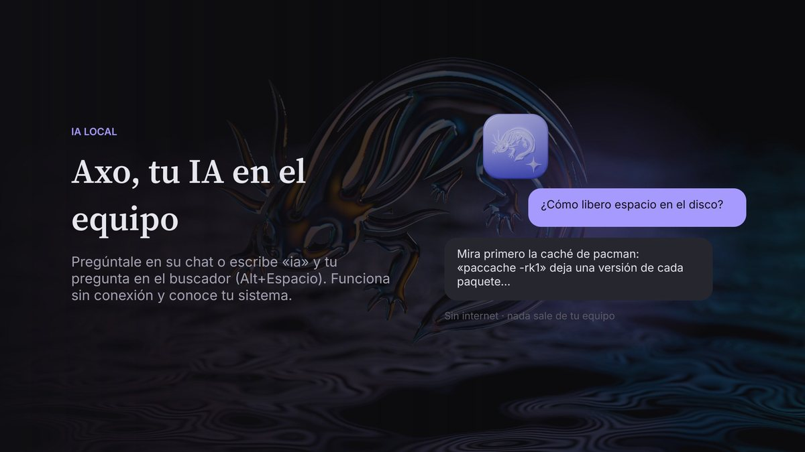

<p align="center">
  
</p>

<h1 align="center">AxolOS</h1>

<p align="center">
  <b>Un escritorio de cristal líquido sobre CachyOS y KDE Plasma, hecho para programar y usar IA en tu propio equipo.</b>
</p>

<p align="center">
  <a href="README.md">English</a> · <b>Español</b> · <a href="README.fr.md">Français</a> · <a href="README.ru.md">Русский</a> · <a href="README.zh-CN.md">简体中文</a> · <a href="README.ja.md">日本語</a>
</p>

<p align="center">
  <a href="https://github.com/SrNoelll/axolos/actions/workflows/comprobar.yml"></a>
  <a href="https://github.com/SrNoelll/axolos/actions/workflows/publicar.yml"></a>
  <a href="https://github.com/SrNoelll/axolos/releases/tag/x86_64"></a>
  
  
  <a href="LICENSE"></a>
</p>


## Lo más destacado

- **Cristal líquido de verdad.** Los paneles, los menús y las ventanas refractan lo que tienen detrás,
  con bordes irisados y filo de luz (efecto *Glass* de KWin), sobre un fondo renderizado en 3D: el
  ajolote de AxolOS hecho de cristal. Oscuro por defecto y con modo claro, o que cambie solo: claro de
  día y oscuro de noche.
- **Axo, tu IA local.** Chat, ayuda con código y comprensión de imágenes con Ollama, afinado para tu
  gráfica. Busca tus archivos por lo que contienen: pulsa Alt+Espacio y escribe
  `ia busco una foto de la playa`. Funciona sin internet y nada sale de tu equipo.
- **Listo para programar.** Perfiles de lenguajes en un paso (`axolos-dev instalar rust python`), git
  con delta, fish con fzf, zoxide y atuin, y temas AxolOS para VS Code, Kate y Neovim.
- **En tu idioma.** AxolOS sigue el idioma del sistema: English, Español, Français, Русский, 简体中文 y
  日本語 (cualquier otro idioma usa el inglés).
- **Actualizaciones de confianza.** Un repositorio de pacman firmado, que compila y publica GitHub
  Actions. Un solo `sudo pacman -Syu` pone al día CachyOS y AxolOS a la vez.

**Modo claro:**


**Iconos de cristal** — las apps de AxolOS, archivos, terminal, ajustes y tus carpetas:


**Instalador** — el Calamares de CachyOS con la marca de AxolOS, en tu idioma:



## Instalar

### En un CachyOS con KDE Plasma

```bash
bash <(curl -fsSL https://raw.githubusercontent.com/SrNoelll/axolos/main/install.sh)
```

Comprueba la huella de la clave de firma, añade el repositorio de AxolOS e instala `axolos-desktop`.
Añade `--apply` para dar el aspecto de AxolOS a tu usuario actual y `--apps` para instalar también la
selección de aplicaciones de AxolOS.

### A mano

```bash
# 1. Confiar en la clave de firma de AxolOS
curl -fsSL https://raw.githubusercontent.com/SrNoelll/axolos/main/axolos.gpg | sudo pacman-key --add -
sudo pacman-key --lsign-key 3F7DA47A1271EB49F17F573F992DB143AB099E91

# 2. Añadir el repositorio al final de /etc/pacman.conf
printf '\n[axolos]\nServer = https://github.com/SrNoelll/axolos/releases/download/x86_64\n' | sudo tee -a /etc/pacman.conf

# 3. Instalar AxolOS (sustituye a cachyos-kde-settings)
sudo pacman -Syu axolos-desktop
```

### Desde cero

`./build-iso.sh` crea una ISO de prueba con el instalador de AxolOS. Con conexión instala la versión
más reciente de todo (CachyOS optimizado para tu procesador y tu gráfica, y AxolOS desde este
repositorio); sin conexión, la versión de la ISO, que se pone al día al conectarte.

## Claro y oscuro

```bash
axolos-aspecto oscuro     # o: claro, auto
```

Lo mismo está en **Centro de AxolOS → Apariencia**. *Automático* usa el cambio de día y noche de Plasma.

## Paquetes

Todos los paquetes son `any` salvo `axolos-glass` (`x86_64`) y sirven en cualquier variante de CachyOS
(x86-64-v3, v4 o Zen 4).

| Paquete | Qué trae |
|---|---|
| `axolos-desktop` | Todo AxolOS de una vez |
| `axolos-glass` | Cristal líquido real en KWin: refracción, bordes irisados y filo de luz |
| `axolos-themes` | Temas globales (oscuro y claro), tema de Plasma, Kvantum, decoraciones, colores, fondos, iconos, inicio de sesión y arranque |
| `axolos-menu` | Bento, el menú de aplicaciones de AxolOS |
| `axolos-kde-settings` | Ajustes de Plasma para usuarios nuevos y `axolos-aspecto` |
| `axolos-branding` | Identidad del sistema, logo, fastfetch y las traducciones de las apps de AxolOS |
| `axolos-ia` | IA local: Ollama afinado, el chat Axo, la búsqueda en KRunner y VS Code conectado |
| `axolos-dev` | Herramientas de desarrollo y perfiles de lenguajes |
| `axolos-bienvenida` | La Bienvenida del primer inicio y el Centro de AxolOS |
| `axolos-keyring` | La clave que firma el repositorio |

También se publican `yaru-icon-theme`, `whitesur-cursor-theme-git` y `ttf-ia-writer` (del AUR). Las
fuentes de Apple (SF Pro, New York) **no** se publican porque su licencia no lo permite: son opcionales
(`paru -S apple-fonts`) y, si no están, AxolOS usa Inter y Source Serif 4.

## Desarrollo

Este repositorio es también el código de AxolOS: los paquetes (`packages/`), la capa sobre el
instalador y la ISO (`iso/`, `build-iso.sh`) y las herramientas que generan el aspecto (`tools/`): los
fondos y los iconos de cristal se renderizan con Blender (`fondo_cristal.py`, `iconos_cristal.py`),
también se generan los marcos de Plasma, Kvantum, los colores y las barras de título, y
`tools/i18n.sh` mantiene al día las seis traducciones. Documentación técnica:
[`docs/DESARROLLO.md`](docs/DESARROLLO.md).

Cada cambio pasa las comprobaciones ([`comprobar.yml`](.github/workflows/comprobar.yml)) y publica los
paquetes que cambiaron ([`publicar.yml`](.github/workflows/publicar.yml)): cada paquete se compila, se
compara con el publicado, se firma y se sube a la release
[`x86_64`](https://github.com/SrNoelll/axolos/releases/tag/x86_64). `axolos-glass` se recompila solo
cada vez que CachyOS publica otra KWin.

Las contribuciones son bienvenidas: mira [CONTRIBUTING.md](CONTRIBUTING.md). Para avisar de un
problema de seguridad, [SECURITY.md](SECURITY.md).

## Créditos

[CachyOS](https://cachyos.org) y [KDE Plasma](https://kde.org/plasma-desktop) ·
el efecto [Glass](https://github.com/4v3ngR/kwin-effects-glass) de KWin, de 4v3ngR (GPL) ·
[MacTahoe](https://github.com/vinceliuice), de Vince Liuice (GPL-3.0), base de los temas de Plasma,
Kvantum y ventanas · los iconos [Yaru](https://github.com/ubuntu/yaru) · Inter, Source Serif 4 y JetBrains Mono.

## Licencia

Código: [GPL-3.0 o posterior](LICENSE). Las imágenes de AxolOS (el ajolote, los fondos, los iconos y
las pantallas de arranque e inicio de sesión) son © Noel Alarcón con licencia
[CC BY-SA 4.0](https://creativecommons.org/licenses/by-sa/4.0/deed.es).
