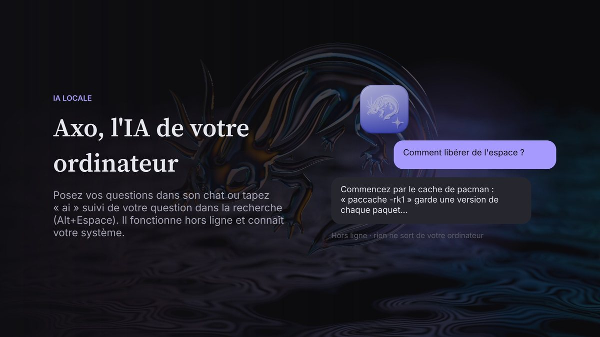

<p align="center">
  
</p>

<h1 align="center">AxolOS</h1>

<p align="center">
  <b>Un bureau en verre liquide sur CachyOS et KDE Plasma, conçu pour programmer et utiliser l'IA sur votre propre ordinateur.</b>
</p>

<p align="center">
  <a href="README.md">English</a> · <a href="README.es.md">Español</a> · <b>Français</b> · <a href="README.ru.md">Русский</a> · <a href="README.zh-CN.md">简体中文</a> · <a href="README.ja.md">日本語</a>
</p>

<p align="center">
  <a href="https://github.com/SrNoelll/axolos/actions/workflows/comprobar.yml"></a>
  <a href="https://github.com/SrNoelll/axolos/actions/workflows/publicar.yml"></a>
  <a href="https://github.com/SrNoelll/axolos/releases/tag/x86_64"></a>
  
  
  <a href="LICENSE"></a>
</p>


## Points forts

- **Du vrai verre liquide.** Les panneaux, les menus et les fenêtres réfractent ce qui se trouve
  derrière eux, avec des bords irisés et un liseré de lumière (effet *Glass* de KWin), sur un fond
  d'écran rendu en 3D : l'axolotl d'AxolOS fait de verre. Sombre par défaut, avec un mode clair — ou
  laissez-le changer tout seul, clair le jour et sombre la nuit.
- **Axo, votre IA locale.** Chat, aide au code et compréhension d'images avec Ollama, réglé pour votre
  carte graphique. Cherchez vos fichiers selon leur contenu : appuyez sur Alt+Espace et tapez
  `ai cherche une photo de la plage`. Il fonctionne hors ligne et rien ne sort de votre ordinateur.
- **Prêt pour les développeurs.** Des profils de langages en une étape (`axolos-dev install rust python`),
  git avec delta, fish avec fzf, zoxide et atuin, et des thèmes AxolOS pour VS Code, Kate et Neovim.
- **Dans votre langue.** AxolOS suit la langue du système : English, Español, Français, Русский,
  简体中文 et 日本語 (toute autre langue utilise l'anglais).
- **Des mises à jour fiables.** Un dépôt pacman signé, compilé et publié par GitHub Actions. Un seul
  `sudo pacman -Syu` met à jour CachyOS et AxolOS ensemble.

**Mode clair :**


**Icônes en verre** — les applications d'AxolOS, fichiers, terminal, réglages et vos dossiers :


**Installateur** — le Calamares de CachyOS aux couleurs d'AxolOS, dans votre langue :



## Installation

### Sur un CachyOS avec KDE Plasma

```bash
bash <(curl -fsSL https://raw.githubusercontent.com/SrNoelll/axolos/main/install.sh)
```

Il vérifie l'empreinte de la clé de signature, ajoute le dépôt AxolOS et installe `axolos-desktop`.
Ajoutez `--apply` pour donner l'apparence d'AxolOS à votre utilisateur actuel, et `--apps` pour
installer aussi la sélection d'applications d'AxolOS.

### À la main

```bash
# 1. Faire confiance à la clé de signature d'AxolOS
curl -fsSL https://raw.githubusercontent.com/SrNoelll/axolos/main/axolos.gpg | sudo pacman-key --add -
sudo pacman-key --lsign-key 3F7DA47A1271EB49F17F573F992DB143AB099E91

# 2. Ajouter le dépôt à la fin de /etc/pacman.conf
printf '\n[axolos]\nServer = https://github.com/SrNoelll/axolos/releases/download/x86_64\n' | sudo tee -a /etc/pacman.conf

# 3. Installer AxolOS (remplace cachyos-kde-settings)
sudo pacman -Syu axolos-desktop
```

### À partir de zéro

`./build-iso.sh` crée une ISO live avec l'installateur d'AxolOS. Avec une connexion, il installe la
version la plus récente de tout (CachyOS optimisé pour votre processeur et votre carte graphique, et
AxolOS depuis ce dépôt) ; sans connexion, la version de l'ISO, qui se met à jour dès que vous êtes connecté.

## Clair et sombre

```bash
axolos-aspecto dark     # ou : light, auto
```

Le même choix se trouve dans **Centre AxolOS → Apparence**. *Automatique* utilise le passage jour/nuit de Plasma.

## Paquets

Tous les paquets sont `any` sauf `axolos-glass` (`x86_64`) et fonctionnent sur toutes les variantes de
CachyOS (x86-64-v3, v4 ou Zen 4).

| Paquet | Ce qu'il apporte |
|---|---|
| `axolos-desktop` | Tout AxolOS d'un coup |
| `axolos-glass` | Du vrai verre liquide dans KWin : réfraction, bords irisés et liseré de lumière |
| `axolos-themes` | Thèmes globaux (sombre et clair), thème Plasma, Kvantum, décorations, couleurs, fonds, icônes, connexion et démarrage |
| `axolos-menu` | Bento, le lanceur d'applications d'AxolOS |
| `axolos-kde-settings` | Réglages Plasma pour les nouveaux utilisateurs et `axolos-aspecto` |
| `axolos-branding` | Identité du système, logo, fastfetch et traductions des applications d'AxolOS |
| `axolos-ia` | IA locale : Ollama réglé, le chat Axo, la recherche KRunner et l'intégration à VS Code |
| `axolos-dev` | Outils de développement et profils de langages |
| `axolos-bienvenida` | L'accueil du premier démarrage et le Centre AxolOS |
| `axolos-keyring` | La clé qui signe le dépôt |

`yaru-icon-theme`, `whitesur-cursor-theme-git` et `ttf-ia-writer` sont aussi publiés (depuis l'AUR).
Les polices d'Apple (SF Pro, New York) ne sont **pas** publiées car leur licence l'interdit : elles sont
facultatives (`paru -S apple-fonts`) et, sans elles, AxolOS utilise Inter et Source Serif 4.

## Développement

Ce dépôt est aussi le code source d'AxolOS : les paquets (`packages/`), la couche sur l'installateur et
l'ISO (`iso/`, `build-iso.sh`) et les outils qui génèrent l'apparence (`tools/`) : les fonds et les
icônes en verre sont rendus avec Blender (`fondo_cristal.py`, `iconos_cristal.py`), les cadres Plasma,
Kvantum, les couleurs et les décorations sont générés eux aussi, et `tools/i18n.sh` garde les six
traductions à jour. Documentation technique (en espagnol) : [`docs/DESARROLLO.md`](docs/DESARROLLO.md).

Chaque modification passe les vérifications ([`comprobar.yml`](.github/workflows/comprobar.yml)) et
publie les paquets qui ont changé ([`publicar.yml`](.github/workflows/publicar.yml)) : chaque paquet est
compilé, comparé à celui publié, signé et envoyé dans la release
[`x86_64`](https://github.com/SrNoelll/axolos/releases/tag/x86_64). `axolos-glass` est recompilé
automatiquement chaque fois que CachyOS publie une nouvelle KWin.

Les contributions sont les bienvenues : voir [CONTRIBUTING.md](CONTRIBUTING.md). Pour signaler un
problème de sécurité : [SECURITY.md](SECURITY.md).

## Remerciements

[CachyOS](https://cachyos.org) et [KDE Plasma](https://kde.org/plasma-desktop) ·
l'effet KWin [Glass](https://github.com/4v3ngR/kwin-effects-glass) de 4v3ngR (GPL) ·
[MacTahoe](https://github.com/vinceliuice) de Vince Liuice (GPL-3.0), base des thèmes Plasma, Kvantum
et des fenêtres · les icônes [Yaru](https://github.com/ubuntu/yaru) · Inter, Source Serif 4 et JetBrains Mono.

## Licence

Code : [GPL-3.0 ou ultérieure](LICENSE). Les visuels d'AxolOS (l'axolotl, les fonds, les icônes et les
écrans de démarrage et de connexion) sont © Noel Alarcón sous licence
[CC BY-SA 4.0](https://creativecommons.org/licenses/by-sa/4.0/deed.fr).
