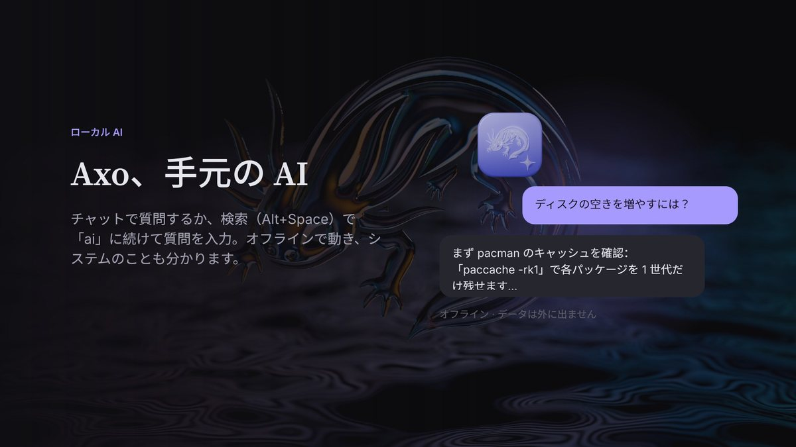

<p align="center">
  
</p>

<h1 align="center">AxolOS</h1>

<p align="center">
  <b>CachyOS と KDE Plasma をベースにしたリキッドガラスのデスクトップ。プログラミングと、自分のパソコンで AI を使うために。</b>
</p>

<p align="center">
  <a href="README.md">English</a> · <a href="README.es.md">Español</a> · <a href="README.fr.md">Français</a> · <a href="README.ru.md">Русский</a> · <a href="README.zh-CN.md">简体中文</a> · <b>日本語</b>
</p>

<p align="center">
  <a href="https://github.com/SrNoelll/axolos/actions/workflows/comprobar.yml"></a>
  <a href="https://github.com/SrNoelll/axolos/actions/workflows/publicar.yml"></a>
  <a href="https://github.com/SrNoelll/axolos/releases/tag/x86_64"></a>
  
  
  <a href="LICENSE"></a>
</p>


## 特長

- **本物のリキッドガラス。** パネル、メニュー、ウィンドウが背後のものを屈折させ、虹色の縁と光の輪郭が
  浮かびます（KWin の *Glass* エフェクト）。壁紙は 3D でレンダリングした、ガラスでできた AxolOS の
  ウーパールーパー。既定はダークで、ライトモードもあります。昼はライト、夜はダークに自動で切り替える
  こともできます。
- **Axo、あなたのローカル AI。** グラフィックスに合わせて調整した Ollama によるチャット、コードの手助け、
  画像の理解。ファイルを中身で検索できます。Alt+Space を押して `ai 探して 海の写真` と入力するだけ。
  オフラインで動き、データがパソコンの外に出ることはありません。
- **開発者向けの準備は万全。** 言語プロファイルをワンステップで（`axolos-dev install rust python`）、
  delta 付きの git、fzf・zoxide・atuin 入りの fish、VS Code・Kate・Neovim 用の AxolOS テーマ。
- **あなたの言語で。** AxolOS はシステムの言語に従います：English、Español、Français、Русский、
  简体中文、日本語（その他の言語では英語）。
- **信頼できるアップデート。** GitHub Actions がビルドして公開する、署名付きの pacman リポジトリ。
  `sudo pacman -Syu` ひとつで CachyOS と AxolOS をまとめて更新します。

**ライトモード：**


**ガラスのアイコン** — AxolOS のアプリ、ファイル、ターミナル、設定、そしてあなたのフォルダー：


**インストーラー** — AxolOS ブランドの CachyOS 版 Calamares を、あなたの言語で：



## インストール

### KDE Plasma の CachyOS で

```bash
bash <(curl -fsSL https://raw.githubusercontent.com/SrNoelll/axolos/main/install.sh)
```

署名鍵のフィンガープリントを確認し、AxolOS リポジトリを追加して `axolos-desktop` をインストールします。
`--apply` を付けると現在のユーザーに AxolOS の見た目を適用し、`--apps` を付けると AxolOS が選んだ
アプリもインストールします。

### 手動で

```bash
# 1. AxolOS の署名鍵を信頼する
curl -fsSL https://raw.githubusercontent.com/SrNoelll/axolos/main/axolos.gpg | sudo pacman-key --add -
sudo pacman-key --lsign-key 3F7DA47A1271EB49F17F573F992DB143AB099E91

# 2. /etc/pacman.conf の末尾にリポジトリを追加する
printf '\n[axolos]\nServer = https://github.com/SrNoelll/axolos/releases/download/x86_64\n' | sudo tee -a /etc/pacman.conf

# 3. AxolOS をインストールする（cachyos-kde-settings を置き換えます）
sudo pacman -Syu axolos-desktop
```

### ゼロから

`./build-iso.sh` は AxolOS インストーラー付きのライブ ISO を作成します。ネットにつながっていれば
すべての最新版（プロセッサーとグラフィックスに最適化された CachyOS と、このリポジトリの AxolOS）を
インストールし、つながっていなければ ISO の版をインストールして、接続後に自動で更新します。

## ライトとダーク

```bash
axolos-aspecto dark     # または light、auto
```

同じ切り替えは **AxolOS センター → 外観** にもあります。*自動* は Plasma の昼夜切り替えを使います。

## パッケージ

`axolos-glass`（`x86_64`）以外はすべて `any` で、CachyOS のどのバリアント（x86-64-v3、v4、Zen 4）でも動きます。

| パッケージ | 内容 |
|---|---|
| `axolos-desktop` | AxolOS 一式 |
| `axolos-glass` | KWin で本物のリキッドガラス：屈折、虹色の縁、光の輪郭 |
| `axolos-themes` | グローバルテーマ（ダークとライト）、Plasma テーマ、Kvantum、ウィンドウ装飾、配色、壁紙、アイコン、ログインと起動画面 |
| `axolos-menu` | AxolOS のアプリメニュー Bento |
| `axolos-kde-settings` | 新規ユーザー向けの Plasma 既定設定と `axolos-aspecto` |
| `axolos-branding` | システムの識別情報、ロゴ、fastfetch、AxolOS アプリの翻訳 |
| `axolos-ia` | ローカル AI：調整済みの Ollama、チャット Axo、KRunner 検索、VS Code 連携 |
| `axolos-dev` | 開発ツールと言語プロファイル |
| `axolos-bienvenida` | 初回起動時のようこそ画面と AxolOS センター |
| `axolos-keyring` | リポジトリに署名する鍵 |

`yaru-icon-theme`、`whitesur-cursor-theme-git`、`ttf-ia-writer`（AUR から）も公開しています。Apple の
フォント（SF Pro、New York）はライセンスで禁止されているため公開して**いません**。任意で
（`paru -S apple-fonts`）、ない場合 AxolOS は Inter と Source Serif 4 を使います。

## 開発

このリポジトリは AxolOS のソースコードでもあります：パッケージ（`packages/`）、インストーラーに
重ねるレイヤーと ISO（`iso/`、`build-iso.sh`）、見た目を生成するツール（`tools/`）。ガラスの壁紙と
アイコンは Blender でレンダリングし（`fondo_cristal.py`、`iconos_cristal.py`）、Plasma の枠、Kvantum、
配色、タイトルバーも生成しています。`tools/i18n.sh` が 6 言語の翻訳をそろえます。技術資料（スペイン語）：
[`docs/DESARROLLO.md`](docs/DESARROLLO.md)。

変更のたびにチェック（[`comprobar.yml`](.github/workflows/comprobar.yml)）が走り、変わったパッケージを
公開します（[`publicar.yml`](.github/workflows/publicar.yml)）。各パッケージはビルドされ、公開済みの
ものと比較され、署名されて [`x86_64`](https://github.com/SrNoelll/axolos/releases/tag/x86_64) リリースに
アップロードされます。CachyOS が新しい KWin を出すたびに `axolos-glass` は自動で再ビルドされます。

貢献を歓迎します：[CONTRIBUTING.md](CONTRIBUTING.md) をご覧ください。セキュリティの問題は
[SECURITY.md](SECURITY.md) へ。

## クレジット

[CachyOS](https://cachyos.org) と [KDE Plasma](https://kde.org/plasma-desktop) ·
4v3ngR による KWin エフェクト [Glass](https://github.com/4v3ngR/kwin-effects-glass)（GPL）·
Vince Liuice による [MacTahoe](https://github.com/vinceliuice)（GPL-3.0）— Plasma、Kvantum、ウィンドウテーマの土台 ·
[Yaru](https://github.com/ubuntu/yaru) アイコン · Inter、Source Serif 4、JetBrains Mono。

## ライセンス

コード：[GPL-3.0 以降](LICENSE)。AxolOS のアートワーク（ウーパールーパー、壁紙、アイコン、起動と
ログインの画面）は © Noel Alarcón、[CC BY-SA 4.0](https://creativecommons.org/licenses/by-sa/4.0/deed.ja) で提供します。
