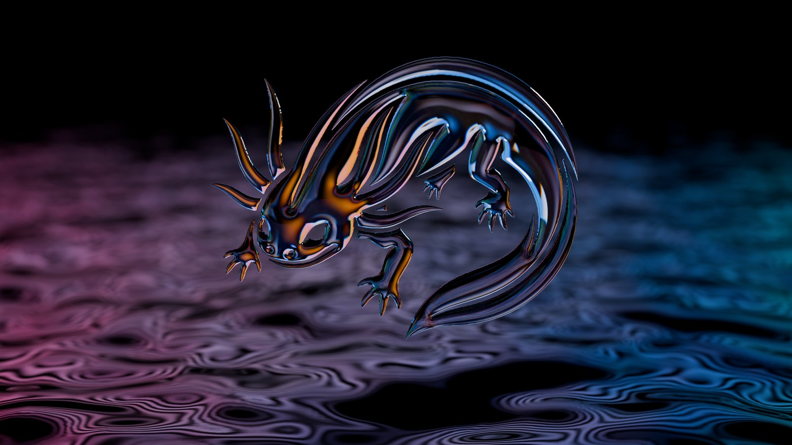
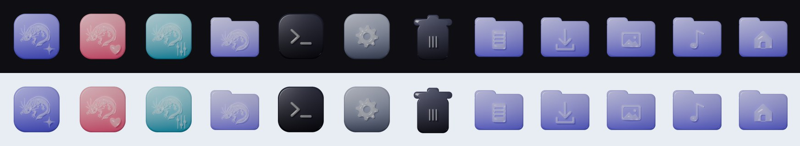
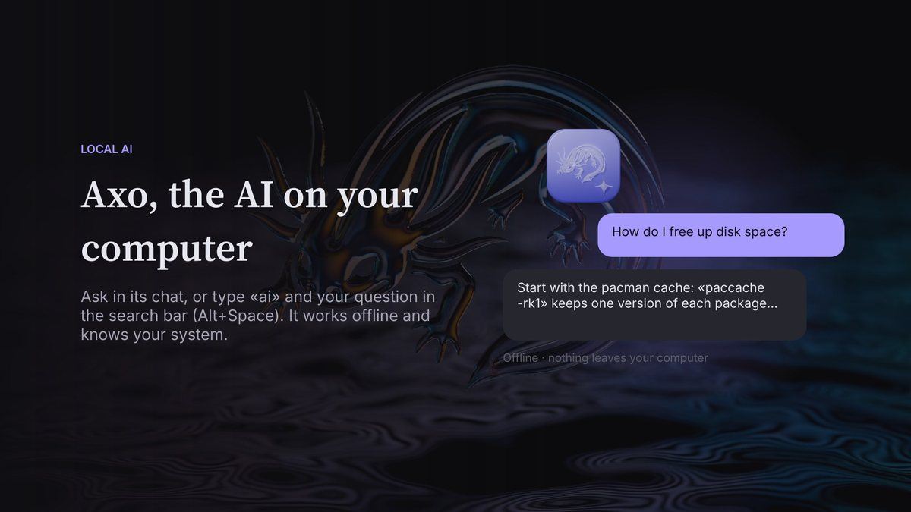

<p align="center">
  
</p>

<h1 align="center">AxolOS</h1>

<p align="center">
  <b>A liquid glass desktop on CachyOS and KDE Plasma — made for coding and running AI on your own computer.</b>
</p>

<p align="center">
  <b>English</b> · <a href="README.es.md">Español</a> · <a href="README.fr.md">Français</a> · <a href="README.ru.md">Русский</a> · <a href="README.zh-CN.md">简体中文</a> · <a href="README.ja.md">日本語</a>
</p>

<p align="center">
  <a href="https://github.com/SrNoelll/axolos/actions/workflows/comprobar.yml"></a>
  <a href="https://github.com/SrNoelll/axolos/actions/workflows/publicar.yml"></a>
  <a href="https://github.com/SrNoelll/axolos/releases/tag/x86_64"></a>
  
  
  <a href="LICENSE"></a>
</p>



## Highlights

- **Liquid glass, for real.** Panels, menus and windows refract what is behind them, with chromatic
  edges and rim light (KWin *Glass* effect), over a 3D-rendered wallpaper: the AxolOS axolotl made
  of glass. Dark by default, with a light mode — or let it switch by itself, light by day and dark at night.
- **Axo, your local AI.** Chat, code help and image understanding with Ollama, tuned for your
  graphics card. Search your files by what they contain: press Alt+Space and type
  `ai find a photo of the beach`. It works offline and nothing leaves your computer.
- **Ready for developers.** Language profiles in one step (`axolos-dev install rust python`),
  git with delta, fish with fzf, zoxide and atuin, and AxolOS themes for VS Code, Kate and Neovim.
- **In your language.** AxolOS follows the system language: English, Español, Français, Русский,
  简体中文 and 日本語 (any other language falls back to English).
- **Updates you can trust.** A signed pacman repository, built and published by GitHub Actions.
  One `sudo pacman -Syu` updates CachyOS and AxolOS together.

**Light mode:**


**Glass icons** — the AxolOS apps, files, terminal, settings and your folders:



**Installer** — CachyOS's Calamares with the AxolOS brand, in your language:



## Install

### On a CachyOS with KDE Plasma

```bash
bash <(curl -fsSL https://raw.githubusercontent.com/SrNoelll/axolos/main/install.sh)
```

It checks the fingerprint of the signing key, adds the AxolOS repository and installs
`axolos-desktop`. Add `--apply` to give your current user the AxolOS look, and `--apps` to install the
AxolOS selection of applications too.

### By hand

```bash
# 1. Trust the AxolOS signing key
curl -fsSL https://raw.githubusercontent.com/SrNoelll/axolos/main/axolos.gpg | sudo pacman-key --add -
sudo pacman-key --lsign-key 3F7DA47A1271EB49F17F573F992DB143AB099E91

# 2. Add the repository at the end of /etc/pacman.conf
printf '\n[axolos]\nServer = https://github.com/SrNoelll/axolos/releases/download/x86_64\n' | sudo tee -a /etc/pacman.conf

# 3. Install AxolOS (replaces cachyos-kde-settings)
sudo pacman -Syu axolos-desktop
```

### From scratch

`./build-iso.sh` builds a live ISO with the AxolOS installer. With a connection it installs the
newest version of everything (CachyOS optimized for your processor and graphics card, plus AxolOS
from this repository); without one, the version on the ISO, which updates itself once you connect.

## Light and dark

```bash
axolos-aspecto dark     # or: light, auto
```

The same switch is in **AxolOS Center → Appearance**. *Auto* uses Plasma's day and night switching.

## Packages

All packages are `any` except `axolos-glass` (`x86_64`) and work on every CachyOS variant
(x86-64-v3, v4 or Zen 4).

| Package | What it brings |
|---|---|
| `axolos-desktop` | All of AxolOS at once |
| `axolos-glass` | Real liquid glass in KWin: refraction, chromatic edges and rim light |
| `axolos-themes` | Global themes (dark and light), Plasma theme, Kvantum, window decorations, colors, wallpapers, icons, login and boot |
| `axolos-menu` | Bento, the AxolOS app launcher |
| `axolos-kde-settings` | Plasma defaults for new users and `axolos-aspecto` |
| `axolos-branding` | System identity, logo, fastfetch and the translations of the AxolOS apps |
| `axolos-ia` | Local AI: tuned Ollama, the Axo chat, KRunner search and VS Code integration |
| `axolos-dev` | Developer tools and language profiles |
| `axolos-bienvenida` | First-run Welcome and the AxolOS Center |
| `axolos-keyring` | The key that signs the repository |

`yaru-icon-theme`, `whitesur-cursor-theme-git` and `ttf-ia-writer` are also published (from the AUR).
Apple fonts (SF Pro, New York) are **not** published because their license forbids it: they are
optional (`paru -S apple-fonts`) and AxolOS falls back to Inter and Source Serif 4.

## Development

This repository is also the source of AxolOS: the packages (`packages/`), the installer layer and the
ISO (`iso/`, `build-iso.sh`) and the tools that generate the look (`tools/`): the glass wallpapers
and icons are rendered with Blender (`fondo_cristal.py`, `iconos_cristal.py`), the Plasma frames,
Kvantum, colors and window decorations are generated too, and `tools/i18n.sh` keeps the six
translations in sync. Technical documentation (in Spanish): [`docs/DESARROLLO.md`](docs/DESARROLLO.md).

Every push runs the checks ([`comprobar.yml`](.github/workflows/comprobar.yml)) and publishes the
packages that changed ([`publicar.yml`](.github/workflows/publicar.yml)): each package is built,
compared with the published one, signed and uploaded to the [`x86_64`](https://github.com/SrNoelll/axolos/releases/tag/x86_64)
release. `axolos-glass` is rebuilt automatically whenever CachyOS ships a new KWin.

Contributions are welcome: see [CONTRIBUTING.md](CONTRIBUTING.md). To report a security problem,
see [SECURITY.md](SECURITY.md).

## Credits

[CachyOS](https://cachyos.org) and [KDE Plasma](https://kde.org/plasma-desktop) ·
the [Glass](https://github.com/4v3ngR/kwin-effects-glass) KWin effect by 4v3ngR (GPL) ·
[MacTahoe](https://github.com/vinceliuice) by Vince Liuice (GPL-3.0), base of the Plasma, Kvantum and
window themes · [Yaru](https://github.com/ubuntu/yaru) icons · Inter, Source Serif 4 and JetBrains Mono.

## License

Code: [GPL-3.0-or-later](LICENSE). The AxolOS artwork (axolotl, wallpapers, icons, boot and login
images) is © Noel Alarcón under [CC BY-SA 4.0](https://creativecommons.org/licenses/by-sa/4.0/).
