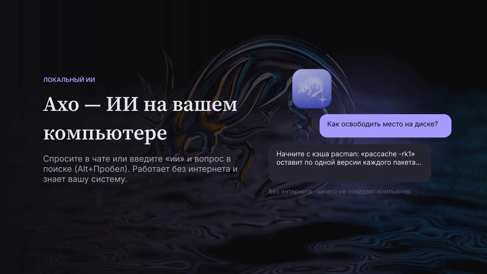

<p align="center">
  
</p>

<h1 align="center">AxolOS</h1>

<p align="center">
  <b>Рабочий стол из жидкого стекла на CachyOS и KDE Plasma — для программирования и ИИ на вашем собственном компьютере.</b>
</p>

<p align="center">
  <a href="README.md">English</a> · <a href="README.es.md">Español</a> · <a href="README.fr.md">Français</a> · <b>Русский</b> · <a href="README.zh-CN.md">简体中文</a> · <a href="README.ja.md">日本語</a>
</p>

<p align="center">
  <a href="https://github.com/SrNoelll/axolos/actions/workflows/comprobar.yml"></a>
  <a href="https://github.com/SrNoelll/axolos/actions/workflows/publicar.yml"></a>
  <a href="https://github.com/SrNoelll/axolos/releases/tag/x86_64"></a>
  
  
  <a href="LICENSE"></a>
</p>


## Главное

- **Настоящее жидкое стекло.** Панели, меню и окна преломляют то, что находится за ними, с радужными
  краями и световой кромкой (эффект KWin *Glass*), поверх обоев, отрисованных в 3D: аксолотль AxolOS
  из стекла. По умолчанию тёмная тема, есть светлая — или пусть переключается сама: днём светлая,
  ночью тёмная.
- **Axo — ваш локальный ИИ.** Чат, помощь с кодом и понимание изображений на Ollama, настроенном под
  вашу видеокарту. Ищите файлы по содержимому: нажмите Alt+Пробел и введите
  `ии найди фото пляжа`. Работает без интернета, и ничего не покидает ваш компьютер.
- **Готов для разработчиков.** Профили языков в один шаг (`axolos-dev install rust python`), git с delta,
  fish с fzf, zoxide и atuin, а также темы AxolOS для VS Code, Kate и Neovim.
- **На вашем языке.** AxolOS следует языку системы: English, Español, Français, Русский, 简体中文 и
  日本語 (для остальных языков — английский).
- **Надёжные обновления.** Подписанный репозиторий pacman, который собирает и публикует GitHub
  Actions. Одна команда `sudo pacman -Syu` обновляет и CachyOS, и AxolOS.

**Светлая тема:**


**Стеклянные значки** — приложения AxolOS, файлы, терминал, настройки и ваши папки:


**Установщик** — Calamares от CachyOS в оформлении AxolOS, на вашем языке:



## Установка

### На CachyOS с KDE Plasma

```bash
bash <(curl -fsSL https://raw.githubusercontent.com/SrNoelll/axolos/main/install.sh)
```

Скрипт проверяет отпечаток ключа подписи, добавляет репозиторий AxolOS и устанавливает `axolos-desktop`.
Добавьте `--apply`, чтобы применить оформление AxolOS к текущему пользователю, и `--apps`, чтобы
установить ещё и подборку приложений AxolOS.

### Вручную

```bash
# 1. Доверить ключу подписи AxolOS
curl -fsSL https://raw.githubusercontent.com/SrNoelll/axolos/main/axolos.gpg | sudo pacman-key --add -
sudo pacman-key --lsign-key 3F7DA47A1271EB49F17F573F992DB143AB099E91

# 2. Добавить репозиторий в конец /etc/pacman.conf
printf '\n[axolos]\nServer = https://github.com/SrNoelll/axolos/releases/download/x86_64\n' | sudo tee -a /etc/pacman.conf

# 3. Установить AxolOS (заменяет cachyos-kde-settings)
sudo pacman -Syu axolos-desktop
```

### С нуля

`./build-iso.sh` собирает live-ISO с установщиком AxolOS. При подключении к сети он устанавливает самые
свежие версии всего (CachyOS, оптимизированный под ваш процессор и видеокарту, и AxolOS из этого
репозитория); без сети — версию с ISO, которая обновится, как только вы подключитесь.

## Светлая и тёмная тема

```bash
axolos-aspecto dark     # или: light, auto
```

То же самое есть в **Центр AxolOS → Внешний вид**. *Автоматически* использует смену дня и ночи в Plasma.

## Пакеты

Все пакеты `any`, кроме `axolos-glass` (`x86_64`), и работают на любом варианте CachyOS
(x86-64-v3, v4 или Zen 4).

| Пакет | Что даёт |
|---|---|
| `axolos-desktop` | Весь AxolOS сразу |
| `axolos-glass` | Настоящее жидкое стекло в KWin: преломление, радужные края и световая кромка |
| `axolos-themes` | Глобальные темы (тёмная и светлая), тема Plasma, Kvantum, рамки окон, цвета, обои, значки, экраны входа и загрузки |
| `axolos-menu` | Bento — меню приложений AxolOS |
| `axolos-kde-settings` | Настройки Plasma для новых пользователей и `axolos-aspecto` |
| `axolos-branding` | Идентичность системы, логотип, fastfetch и переводы приложений AxolOS |
| `axolos-ia` | Локальный ИИ: настроенный Ollama, чат Axo, поиск в KRunner и интеграция с VS Code |
| `axolos-dev` | Инструменты разработчика и профили языков |
| `axolos-bienvenida` | Приветствие при первом запуске и Центр AxolOS |
| `axolos-keyring` | Ключ, которым подписан репозиторий |

Также публикуются `yaru-icon-theme`, `whitesur-cursor-theme-git` и `ttf-ia-writer` (из AUR). Шрифты
Apple (SF Pro, New York) **не** публикуются, так как их лицензия это запрещает: они необязательны
(`paru -S apple-fonts`), а без них AxolOS использует Inter и Source Serif 4.

## Разработка

Этот репозиторий — также исходный код AxolOS: пакеты (`packages/`), слой поверх установщика и ISO
(`iso/`, `build-iso.sh`) и инструменты, которые создают оформление (`tools/`): стеклянные обои и
значки рендерятся в Blender (`fondo_cristal.py`, `iconos_cristal.py`), рамки Plasma, Kvantum, цвета и
заголовки окон тоже генерируются, а `tools/i18n.sh` поддерживает шесть переводов в актуальном
состоянии. Техническая документация (на испанском): [`docs/DESARROLLO.md`](docs/DESARROLLO.md).

Каждое изменение проходит проверки ([`comprobar.yml`](.github/workflows/comprobar.yml)) и публикует
изменившиеся пакеты ([`publicar.yml`](.github/workflows/publicar.yml)): каждый пакет собирается,
сравнивается с опубликованным, подписывается и загружается в релиз
[`x86_64`](https://github.com/SrNoelll/axolos/releases/tag/x86_64). `axolos-glass` пересобирается
автоматически всякий раз, когда CachyOS выпускает новую KWin.

Мы рады вашему участию: см. [CONTRIBUTING.md](CONTRIBUTING.md). О проблемах безопасности:
[SECURITY.md](SECURITY.md).

## Благодарности

[CachyOS](https://cachyos.org) и [KDE Plasma](https://kde.org/plasma-desktop) ·
эффект KWin [Glass](https://github.com/4v3ngR/kwin-effects-glass) от 4v3ngR (GPL) ·
[MacTahoe](https://github.com/vinceliuice) от Vince Liuice (GPL-3.0) — основа тем Plasma, Kvantum и
окон · значки [Yaru](https://github.com/ubuntu/yaru) · Inter, Source Serif 4 и JetBrains Mono.

## Лицензия

Код: [GPL-3.0 или более поздняя](LICENSE). Графика AxolOS (аксолотль, обои, значки, экраны загрузки
и входа) — © Noel Alarcón, лицензия [CC BY-SA 4.0](https://creativecommons.org/licenses/by-sa/4.0/deed.ru).
