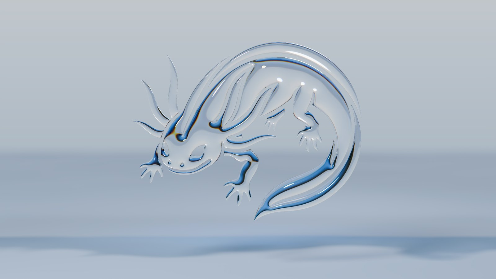
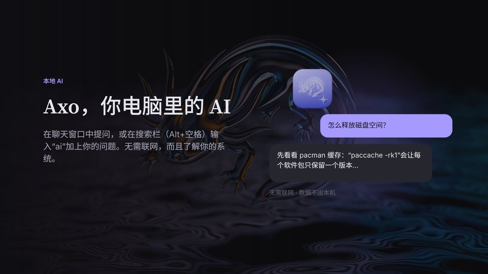

<p align="center">
  
</p>

<h1 align="center">AxolOS</h1>

<p align="center">
  <b>基于 CachyOS 和 KDE Plasma 的液态玻璃桌面，专为编程和在自己的电脑上运行 AI 而打造。</b>
</p>

<p align="center">
  <a href="README.md">English</a> · <a href="README.es.md">Español</a> · <a href="README.fr.md">Français</a> · <a href="README.ru.md">Русский</a> · <b>简体中文</b> · <a href="README.ja.md">日本語</a>
</p>

<p align="center">
  <a href="https://github.com/SrNoelll/axolos/actions/workflows/comprobar.yml"></a>
  <a href="https://github.com/SrNoelll/axolos/actions/workflows/publicar.yml"></a>
  <a href="https://github.com/SrNoelll/axolos/releases/tag/x86_64"></a>
  
  
  <a href="LICENSE"></a>
</p>


## 亮点

- **真正的液态玻璃。** 面板、菜单和窗口会折射身后的内容，带有彩虹般的边缘和高光轮廓（KWin *Glass*
  效果），背景是一张 3D 渲染的壁纸：由玻璃制成的 AxolOS 美西螈。默认深色，也有浅色模式——
  或者让它自动切换：白天浅色，夜晚深色。
- **Axo，你的本地 AI。** 基于 Ollama 的聊天、编程帮助和图像理解，并针对你的显卡进行了优化。
  按内容搜索文件：按 Alt+空格，输入 `ai 找一下海滩的照片`。无需联网，数据不会离开你的电脑。
- **为开发者准备就绪。** 一步安装编程语言配置（`axolos-dev install rust python`），带 delta 的 git，
  配有 fzf、zoxide 和 atuin 的 fish，以及适用于 VS Code、Kate 和 Neovim 的 AxolOS 主题。
- **使用你的语言。** AxolOS 跟随系统语言：English、Español、Français、Русский、简体中文和日本語
  （其他语言使用英语）。
- **值得信赖的更新。** 由 GitHub Actions 构建和发布的签名 pacman 软件仓库。一条 `sudo pacman -Syu`
  即可同时更新 CachyOS 和 AxolOS。

**浅色模式：**



**玻璃图标**——AxolOS 应用、文件、终端、设置以及你的文件夹：


**安装程序**——带有 AxolOS 品牌的 CachyOS Calamares，使用你的语言：



## 安装

### 在装有 KDE Plasma 的 CachyOS 上

```bash
bash <(curl -fsSL https://raw.githubusercontent.com/SrNoelll/axolos/main/install.sh)
```

脚本会校验签名密钥的指纹，添加 AxolOS 软件仓库并安装 `axolos-desktop`。加上 `--apply` 可将 AxolOS
外观应用到当前用户，加上 `--apps` 还会安装 AxolOS 精选的应用。

### 手动安装

```bash
# 1. 信任 AxolOS 的签名密钥
curl -fsSL https://raw.githubusercontent.com/SrNoelll/axolos/main/axolos.gpg | sudo pacman-key --add -
sudo pacman-key --lsign-key 3F7DA47A1271EB49F17F573F992DB143AB099E91

# 2. 在 /etc/pacman.conf 末尾添加软件仓库
printf '\n[axolos]\nServer = https://github.com/SrNoelll/axolos/releases/download/x86_64\n' | sudo tee -a /etc/pacman.conf

# 3. 安装 AxolOS（替代 cachyos-kde-settings）
sudo pacman -Syu axolos-desktop
```

### 全新安装

`./build-iso.sh` 会构建带有 AxolOS 安装程序的 Live ISO。联网时会安装所有内容的最新版本（针对你的
处理器和显卡优化的 CachyOS，以及来自本仓库的 AxolOS）；不联网时安装 ISO 中的版本，联网后会自动更新。

## 浅色与深色

```bash
axolos-aspecto dark     # 或：light、auto
```

同样的选项也在 **AxolOS 中心 → 外观** 中。*自动* 使用 Plasma 的日夜切换。

## 软件包

除 `axolos-glass`（`x86_64`）外，所有软件包都是 `any`，适用于所有 CachyOS 变体（x86-64-v3、v4 或 Zen 4）。

| 软件包 | 内容 |
|---|---|
| `axolos-desktop` | 一次安装全部 AxolOS |
| `axolos-glass` | KWin 中真正的液态玻璃：折射、彩虹边缘和高光轮廓 |
| `axolos-themes` | 全局主题（深色和浅色）、Plasma 主题、Kvantum、窗口装饰、配色、壁纸、图标、登录和启动画面 |
| `axolos-menu` | Bento，AxolOS 的应用菜单 |
| `axolos-kde-settings` | 新用户的 Plasma 默认设置和 `axolos-aspecto` |
| `axolos-branding` | 系统标识、标志、fastfetch 以及 AxolOS 应用的翻译 |
| `axolos-ia` | 本地 AI：优化过的 Ollama、Axo 聊天、KRunner 搜索和 VS Code 集成 |
| `axolos-dev` | 开发工具和编程语言配置 |
| `axolos-bienvenida` | 首次启动的欢迎程序和 AxolOS 中心 |
| `axolos-keyring` | 为软件仓库签名的密钥 |

同时发布 `yaru-icon-theme`、`whitesur-cursor-theme-git` 和 `ttf-ia-writer`（来自 AUR）。Apple 字体
（SF Pro、New York）因许可证禁止而**不**发布：它们是可选的（`paru -S apple-fonts`），没有它们时
AxolOS 使用 Inter 和 Source Serif 4。

## 开发

本仓库也是 AxolOS 的源代码：软件包（`packages/`）、安装程序之上的定制层和 ISO（`iso/`、
`build-iso.sh`），以及生成外观的工具（`tools/`）：玻璃壁纸和图标用 Blender 渲染（`fondo_cristal.py`、
`iconos_cristal.py`），Plasma 边框、Kvantum、配色和窗口标题栏同样由工具生成，`tools/i18n.sh` 保持
六种翻译同步。技术文档（西班牙语）：[`docs/DESARROLLO.md`](docs/DESARROLLO.md)。

每次提交都会运行检查（[`comprobar.yml`](.github/workflows/comprobar.yml)），并发布有变化的软件包
（[`publicar.yml`](.github/workflows/publicar.yml)）：每个软件包都会被构建、与已发布版本比较、签名并
上传到 [`x86_64`](https://github.com/SrNoelll/axolos/releases/tag/x86_64) 发布。每当 CachyOS 发布新的
KWin，`axolos-glass` 都会自动重新构建。

欢迎贡献：参见 [CONTRIBUTING.md](CONTRIBUTING.md)。报告安全问题：[SECURITY.md](SECURITY.md)。

## 致谢

[CachyOS](https://cachyos.org) 和 [KDE Plasma](https://kde.org/plasma-desktop) ·
4v3ngR 的 KWin 效果 [Glass](https://github.com/4v3ngR/kwin-effects-glass)（GPL）·
Vince Liuice 的 [MacTahoe](https://github.com/vinceliuice)（GPL-3.0），是 Plasma、Kvantum 和窗口主题的基础 ·
[Yaru](https://github.com/ubuntu/yaru) 图标 · Inter、Source Serif 4 和 JetBrains Mono。

## 许可证

代码：[GPL-3.0 或更高版本](LICENSE)。AxolOS 的美术作品（美西螈、壁纸、图标、启动和登录画面）
版权归 Noel Alarcón 所有，采用 [CC BY-SA 4.0](https://creativecommons.org/licenses/by-sa/4.0/deed.zh-hans) 许可。
